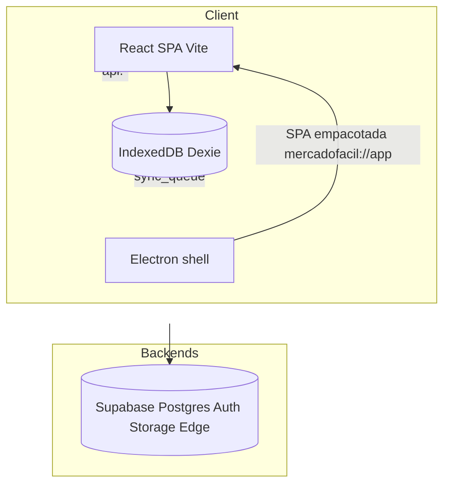
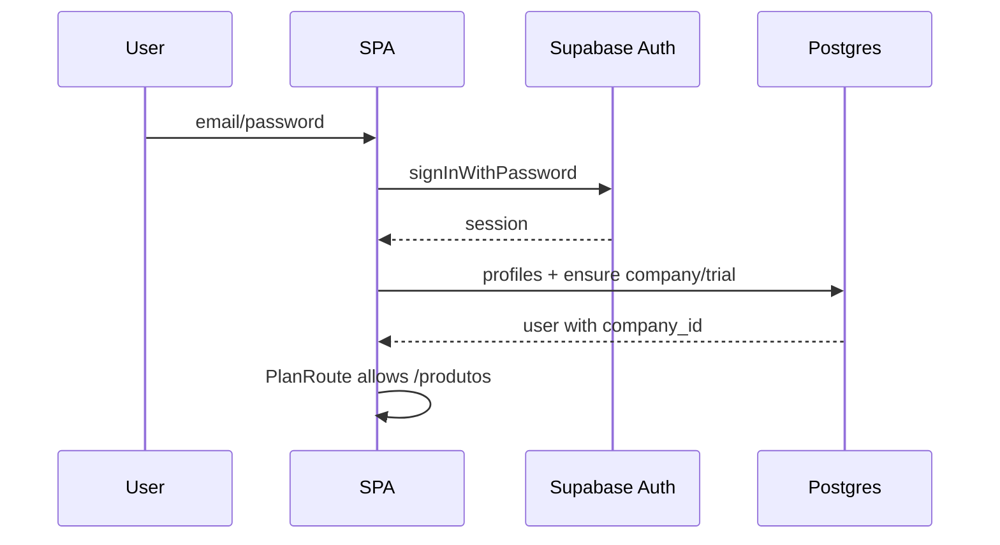
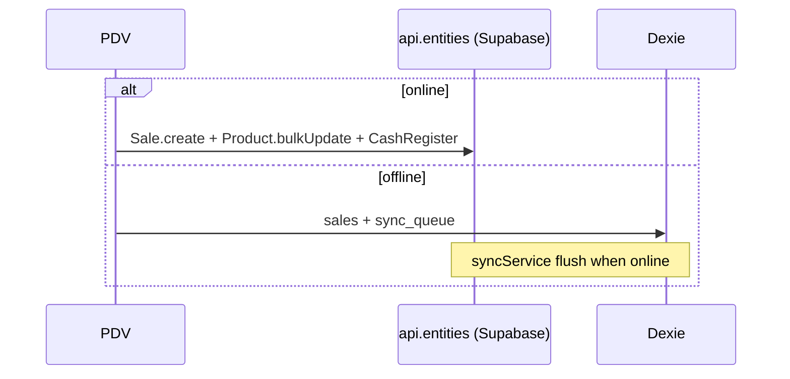

# Codebase Map

> Auto-generated by Cartographer. Last mapped: 2026-09-15T18:21:34Z

## System Overview

MercadoFácil PDV — SPA React/Vite for minimercado PDV (vendas, estoque, caixa, clientes, fiscal local, planos). Branch `migration/supabase`: runtime = **Supabase** via `api` (`dataClient` → `supabaseData`). Preview Vercel validado; produção (`main` / `mercado-facil-pdv.vercel.app`) **não** promovida até cutover A+F.



## Directory Structure

```
src/
  api/           # dataClient (façade api.*) + supabaseData (CRUD/auth/Edge)
  lib/           # AuthContext, sync, dataLayer, productStore, nfce, pix, plans
  pages/         # Rotas: PDV, Products, Customers, Sales, …
  components/    # pos, cash, products, customers, config, integracoes, …
legacy/          # Base44 entities/functions arquivados (não no bundle)
electron/        # Shell desktop: serve dist/ offline + auto-update (electron-updater)
supabase/        # migrations 001–007 + functions (PIX, planos, roles)
scripts/         # smoke-*.mjs + migrate/ export-import
docs/            # CODEBASE_MAP.md (this file)
```

## Module Guide

### API / Auth / Data core

**Purpose**: Sessão, tenant bootstrap, CRUD unificado.  
**Entry**: `src/api/dataClient.js`, `src/lib/AuthContext.jsx`, `src/App.jsx`

| File | Purpose |
|------|---------|
| `dataClient.js` | Façade `api.entities/auth/functions/integrations` |
| `supabaseData.js` | Map entity→table; `authMe` + ensure company/trial; Edge invoke |
| `supabase.js` | `createClient` (exige `VITE_SUPABASE_*`) |
| `AuthContext.jsx` | Session Supabase + demo + offline cache |
| `planAccess.js` / `PlanRoute` | Exige `company_id` + plano trial/active |
| `dataLayer.js` / `syncService.js` / `localdb.js` | Offline-first Dexie + `sync_queue` |
| `productStore.js` | Product/Category CRUD (online → Supabase) |

**Gotchas**: Upload assume bucket `public`; order default `created_at`.

### Pages

**Purpose**: Telas de rota. PDV é o hub operacional.

| Page | Role | Main entities |
|------|------|----------------|
| `PDV.jsx` | Venda, caixa, NFC-e, offline sale | Sale, Product, CashRegister, Customer |
| `Products.jsx` | Catálogo | productStore → Product/Category |
| `Customers.jsx` | CRM / fiado | Customer |
| `Sales.jsx` | Histórico / cancel | Sale, Product, Customer |
| `CashRegister.jsx` | Lista caixas | CashRegister |
| `Login`/`Register` | Auth | auth.* |
| `Empresa`/`Empresas` | Onboarding / platform admin | Company + functions |
| `Configuracoes` / `Integracoes` | Settings & partners | localStorage + PIX functions |

**Gotchas PDV**: product list cap 500; número de venda = last+1 (race); stock online via bulkUpdate absoluto.

### POS / Cash / Products / Customers components

**Purpose**: Dialogs do PDV e back-office.

- Checkout: dinheiro/PIX/cartão/crediário → `generatePixPayment` (Edge Supabase) ou BR Code manual  
- Offline sale → `createSaleOffline` + enqueue  
- Stock ops: StockMovement / Convert / Inventário  
- ValePresenteDialog: orphan (não ligado)

### Config / Integrations / Reports / Landing

| Area | Notes |
|------|-------|
| PagamentoTab | MP token local + webhook URL Supabase |
| FiscalTab + nfce.js | XML/DANFE local; SEFAZ não transmitida |
| Integracoes | MP, WhatsApp add-on PIX, Sicredi localStorage, Meta Pixel |
| Reports | ~15 relatórios sobre Sale/Product/Bill/ActivityLog |
| Landing | Marketing Framer Motion |

### Backend + Electron + Supabase

| Piece | Role |
|-------|------|
| `legacy/base44-*` | Arquivo histórico (entities/functions Base44) |
| Edge Functions | PIX, webhook MP, register/list/activate company, invite, assign-role |
| Electron | SPA empacotada (offline) + auto-update; Dexie em userData; sem `.base44.app` |
| migrations 001–010 | Schema + RLS tenant + client_id unique + stock RPC idempotente + numeração de venda |

## Data Flow

### Auth (branch migration/supabase)



### Sale online vs offline



## Conventions

- Imports: `@/` → `src/`
- UI: Radix + Tailwind + sonner toasts
- Entity API style retained: `list(order, limit)`, `filter(eq)`, `create/update/delete`
- Offline: Dexie `MercadoFacilPDV` + `client_id` idempotency on Sale/Customer/open cash
- Multi-tenant field: `company_id` (write via `withCompanyId` / ensureTenant)

## Gotchas

1. **Dual backend**: produção Vercel ainda pode ter env Base44 antigo; branch `migration/supabase` + preview = Supabase. Não promover `--prod` até A/F/G validados.
2. **RLS 001** foi permissivo; **002** obrigatório para isolamento real (smoke test).
3. **Confirm email** Supabase bloqueia sessão no signup até desativar em Providers.
4. **PIX/webhook** = Edge Functions Supabase; falta `MERCADO_PAGO_ACCESS_TOKEN` para teste real.
5. **Fiscal**: geração local only.
6. **Duas APIs de catálogo**: `dataLayer` (PDV/sync) vs `productStore` (CRUD); creates offline em `productStore` usam `local-*` **sem** enqueue — não sincronizam.
7. **IDs `local_*`**: sem remap para UUID cloud após sync (caixa/cliente/venda offline).
8. **Stock/crédito**: decremento local + sync; retries de cash/credit deltas não são idempotentes.
9. **InviteDialog** → `invite-user` Edge Function (smoke PASS).
10. Cap listagens 200–500; Backup `count` com `list(...,1)` engana; import Backup duplica.
11. **Empresa vs Configurações**: campos diferentes (`trade_name`/`document` vs `name`/`cnpj`).
12. Orphans: `ValePresenteDialog`, `InventoryDialog`, `useOfflineSync` (legado).
13. **Legado Base44** em `legacy/` apenas; runtime = `src/api/dataClient.js` + Supabase.

## Navigation Guide

| Task | Touch |
|------|--------|
| Add PDV payment UI | `CheckoutDialog.jsx`, `PDV.jsx` |
| Add product field | `ProductDialog`, `safePayload.PRODUCT_FIELDS`, schema Supabase |
| Change auth | `AuthContext`, `supabaseData`, Login/Register |
| Offline sync op | `syncService.js` handlers + `dataLayer` enqueue |
| PIX | `supabase/functions/generate-pix-payment`, Checkout/PagamentoTab |
| Tenant/RLS | `supabase/migrations/002_tenant_rls.sql`, `companyContext.js` |
| Release desktop | `scripts/release-desktop.mjs`, `electron/main.cjs`, `electron-builder.yml` |
| Deploy SPA | `vercel.json` + preview; prod só após cutover |

## Scan stats

- Scanner files: **315** · tokens ~**408k** (inclui artefatos `graphify-out`/`release` no scan bruto)
- Agents: core API/lib, pages, pos/cash/products/customers, config/integrations, base44/electron/supabase
